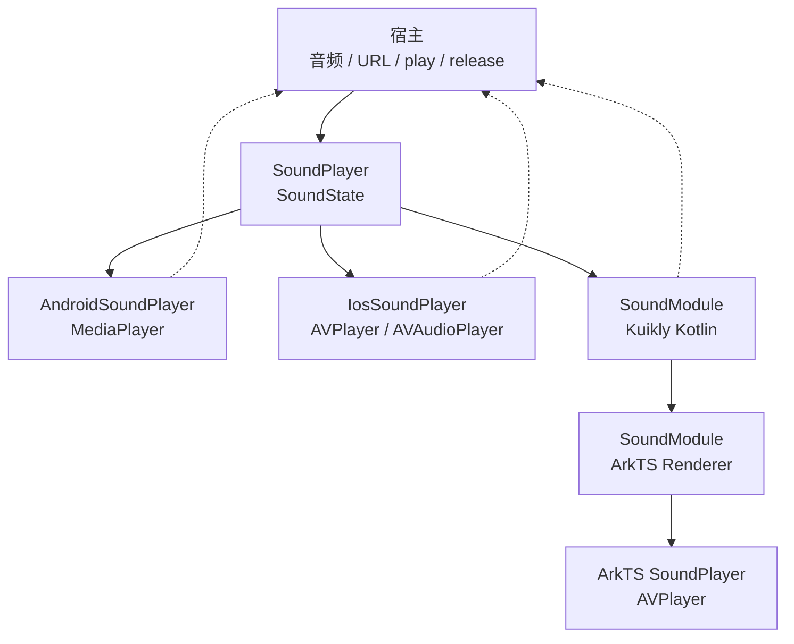
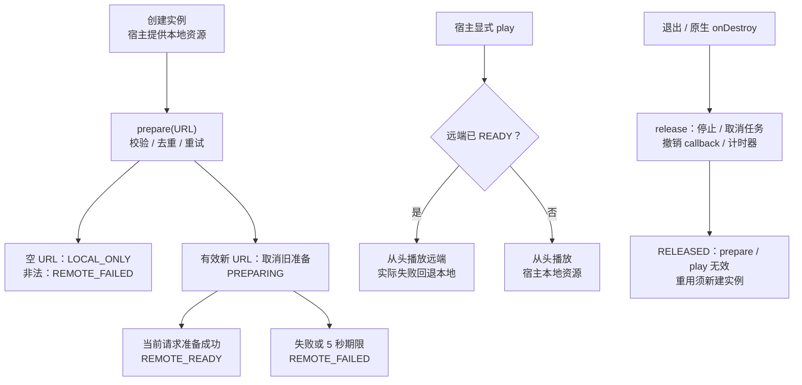
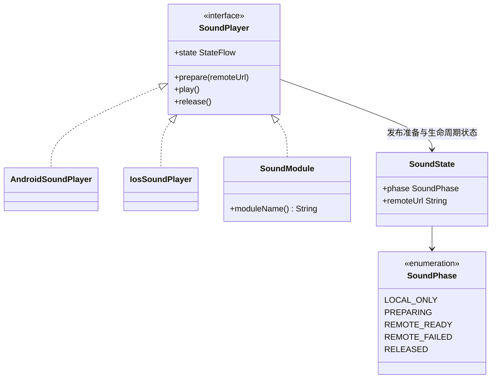

# GY CrossKit Sound

新版 Maven 发布由 Jenkins 生成同版本归档、`source-receipt.json` 和 `SHA256SUMS`。JitPack 核对标签来源、归档尺寸和摘要后安装同一份制品。历史发布按原版本 Tag 复验。

Kuikly 由宿主统一选择版本；组件构建基线、允许范围及消费验证边界见[功能与平台差异](docs/功能与平台差异.md#kuikly-版本与宿主选择)。

> 统一版本候选 `1.0.2`：Maven 与 iOS Git Pod（`native-1.0.2`）待发布；私有 OHPM 沿用已发布的 `1.0.2`，不重新构建或提交。已发布 Maven `1.0.1`、Git Pod `native-1.0.1` 与旧摘要保持不变；新候选构建、公开消费和设备验收分别留证。

组件构建最低基线为 Kuikly 2.29.1；允许范围、宿主选择及 2.30 消费边界见[功能与平台差异](docs/功能与平台差异.md#kuikly-版本与宿主选择)。带日期的历史结果不代替当前渠道验收。

## 当前功能与平台边界

当前候选 Maven 与 Git Pod 均为 `1.0.2`（`native-1.0.2`），`GYCSound/Kuikly`。Android/iOS Native Module 接线见[接入指南](docs/接入指南.md#androidios-native-module)。发布及远程消费状态以对应 Release 证据为准。

core 提供单短音效播放器、远端 HTTPS 预缓冲和本地回退；无 CMP UI。`sound-kuikly` 提供 Android/iOS/OHOS 页面 Module、Android receiver 和可选 iOS Pod receiver，仍复用原生 core 播放器。

历史发布基线：Maven 0.1.5；HAR 0.1.2。本次修复与平台边界见[功能与平台差异](docs/功能与平台差异.md)，构建与渠道验收见[版本发布记录](https://github.com/gycrosskit/sound/releases/tag/0.1.5)。

当前测试覆盖、执行时点和未验收项集中见[验证范围](docs/功能与平台差异.md#验证范围)，复现命令见[开发与验证](docs/开发与验证.md)。

此版本包含已复核的跨端行为修复；[历史源码候选记录](docs/跨端行为候选.md)和历史发布验收保持其原时点，当前范围见顶部功能与平台差异。

Android、iOS 和 HarmonyOS 的单个短音效播放器，支持 HTTPS 预加载、从头重播、宿主本地资源回退、准备状态和生命周期释放。音频文件、开关和业务事件由宿主提供。

历史发布验收：[0.1.3](docs/0.1.3远程发布验收.md)、[0.1.2](docs/0.1.2远程发布验收.md)。

## 架构与调用流程

宿主拥有一个短音效实例，提供本地音频、远端 URL 和播放触发；组件只管理准备、重播与释放。Kotlin 共享契约和 URL / 准备状态规则，真正播放落到各平台原生播放器。



`prepare()` 立即返回，准备结果异步更新；准备成功不自动播放。三端都使用原生网络预缓冲，不完整下载到库内 ByteArray/NSData，不能当作离线缓存。



Android/iOS `release()` 在 Main 上同步执行；后台调用排入 Main，观察 `state.phase == RELEASED` 确认关闭已执行，调用返回本身不保证资源已释放。Kuikly Kotlin `release()` 在所属页面线程同步关闭桥资格，不能由 Kotlin 状态推断原生资源已释放。OHOS 原生 `release()` 立即发布 RELEASED，并返回等待本地 AVPlayer 与 rawfile 描述符串行释放的 Promise；远端异步释放已经发起，不属于该 Promise 的完成保证。Android 按播放器对象、iOS/OHOS 按 generation 拒绝替换或释放前的迟回调；Kuikly Kotlin `release()` 移除常驻 callback 并异步通知原生。



源码入口：[共享契约与 URL 规则](sound-core/src/commonMain/kotlin/io/github/gycrosskit/sound/SoundPlayer.kt)、[Android 播放器](sound-core/src/androidMain/kotlin/io/github/gycrosskit/sound/AndroidSoundPlayer.kt)、[iOS 原生预缓冲与 generation](sound-core/src/iosMain/kotlin/io/github/gycrosskit/sound/IosSoundPlayer.kt)、[Kuikly Kotlin callback](sound-kuikly/src/commonMain/kotlin/io/github/gycrosskit/sound/kuikly/SoundModule.kt)、[OHOS Renderer](ohos/sound-native/src/main/ets/SoundModule.ets)、[OHOS 播放与串行释放](ohos/sound-native/src/main/ets/SoundPlayer.ets)。SoundState 不表示正在播放或本地资源可用；缺失或不可解码的本地资源会结束该次播放。

## 平台与模块

| 模块 | 平台与要求 |
| --- | --- |
| `sound-core` | Android API 24+ / iOS（建议宿主 iOS 14+）；`SoundPlayer` / `SoundState` 和原生实现 |
| `sound-kuikly` | Android/iOS/OHOS Kotlin Module、Android receiver；Kuikly `2.29.1-2.0.21-ohos` |
| `@gycrosskit/sound` | HarmonyOS HAR，兼容 API 22；ArkTS 播放器与 Kuikly Renderer Module |

KMP 基线为 OpenHarmony Kotlin `2.2.21-1.0.0` / JDK 21 / Gradle 8.11.1 / AGP 8.10.1，coroutines `1.10.2-1.0.0`、Ktor `3.3.3-1.1.0-04`。iOS 编译/链接需 macOS / Xcode。Core 的 OHOS 变体仅提供公共契约，实际播放需原生 HAR。HAR 使用 API 26 SDK 构建，API 22 真机兼容尚未验收。

## 安装

在项目的 `settings.gradle.kts` 中配置：

```kotlin
dependencyResolutionManagement {
    repositories {
        google()
        mavenCentral()
        maven { url = uri("https://jitpack.io") }
        maven { url = uri("https://maven.eazytec-cloud.com/nexus/repository/maven-public/") }
        maven { url = uri("https://mirrors.tencent.com/nexus/repository/maven-tencent/") }
        exclusiveContent {
            forRepository {
                maven { url = uri("https://mirrors.tencent.com/nexus/repository/maven-tencent/") }
            }
            filter { includeGroup("com.tencent.kuikly-open") }
        }
    }
}
```

共享模块 `build.gradle.kts`：

```kotlin
kotlin {
    sourceSets {
        commonMain.dependencies {
            implementation("com.github.gycrosskit.sound:sound-core:1.0.2")
        }
    }
}
```

HarmonyOS 原生宿主通过私有 OHPM 安装精确版本 `1.0.2`，以对应 Registry 查询和 Jenkins 回执为准：

```sh
ohpm install @gycrosskit/sound@1.0.2
```

插件仓库、Kuikly 依赖及注册见[接入指南](docs/接入指南.md)。本轮仅补齐 Maven/Git Pod `1.0.2`，HAR 沿用既有版本。

## 快速使用

Android 在 `androidMain` 创建播放器，音频文件放入宿主 `res/raw`：

```kotlin
import io.github.gycrosskit.sound.AndroidSoundPlayer

val sound = AndroidSoundPlayer(context, R.raw.host_sound)
sound.prepare("https://cdn.example.com/sound.wav")
sound.play()
// 页面或拥有播放器的会话退出时：
sound.release()
```

iOS 使用 `IosSoundPlayer("host_sound", "wav")`，文件放入宿主 Bundle；ArkTS 使用 `SoundPlayer(resourceManager, "host_sound.wav", onState)`，文件放入宿主 `resources/rawfile`。详细示例见接入指南。

`prepare()` 异步准备远端且不会自动播放。`play()` 从头重播，远端未就绪或播放失败时使用本地资源；本地不可用则静默结束。实例只播放一个短音效，不提供混音或队列。

`state` 只表示 `LOCAL_ONLY / PREPARING / REMOTE_READY / REMOTE_FAILED / RELEASED`，不表示正在播放。Android/iOS 的 prepare/play/release 可由任意线程调用：Main 立即执行，后台排入 Main；播放器创建、回调、超时、替换与释放共用 Main。Kuikly 使用所属页面线程。后台 `release()` 返回不代表已完成，以 `state.phase == RELEASED` 确认；关闭后排队请求不能复活实例。`release()` 永久关闭且可重复调用，再次使用需新实例；ArkTS 的释放包含异步资源清理。

三端使用原生网络预缓冲且无库内文件字节上限，不保证离线播放。宿主限制文件大小、时长及 HTTPS 重定向链，iOS 音频会话由宿主管理。

## 文档与支持

- [接入指南](docs/接入指南.md)：资源、Swift 导出、Kuikly、状态及超时边界。
- [开发与验证](docs/开发与验证.md)、[历史验证记录](VERIFICATION.md)：构建和独立消费范围。
- [GitHub Releases](https://github.com/gycrosskit/sound/releases)：Maven 版本和归档。
- [GitHub Issues](https://github.com/gycrosskit/sound/issues)：提供平台、版本、音频格式和最小复现。

现有记录覆盖远程 Maven / OHPM 产物编译、iOS Simulator 链接、Swift typecheck 和行为替身测试；真机播放、音频会话及 API 22 设备兼容仍待宿主验收。

自有源码使用 [Apache-2.0](LICENSE)，第三方依赖遵循各自许可。

本轮全生产文件覆盖与未测项见[完整源码审查](docs/完整源码审查.md)。

## 自动回归

源码回归使用 `component-ci/verify`，见[统一远程验证（Jenkins）](https://github.com/gycrosskit/.github/blob/main/docs/统一远程验证.md)，按已推送源码 ref/SHA 选择对应组件；平台命令与参数以受信 Jenkins recipe 为准。实际执行范围、测试数量、结果与耗时以绑定源码/CI SHA 的构建回执为准，轻量检查或跳过不算平台测试通过。

HarmonyOS 通过私有 OHPM 分发，精确版本的 Registry 安装与 ArkTS 消费按发布回执核对。

新版本按[发布流程](https://github.com/gycrosskit/.github/blob/main/docs/发布流程.md)执行 `component-ci/release`。按渠道绑定准确的源码 SHA、版本和必要的 Tag，在同一次 Run 冻结候选并核对远端制品，保留发布和消费回执。

HAR 使用受管 HarmonyOS CLT 构建。KLIB 编译、Registry 安装及真机验收分别按实际回执记录。

阶段、缓存、有限网络重试、失败记录与证据边界见[共用 CI 规则](https://github.com/gycrosskit/.github/blob/main/docs/持续集成门禁.md)；本库实际平台命令以 Jenkins 的固定版本 recipe 为准。源码通过、远程消费、HAR/ohpm 与设备验收分别记录。
